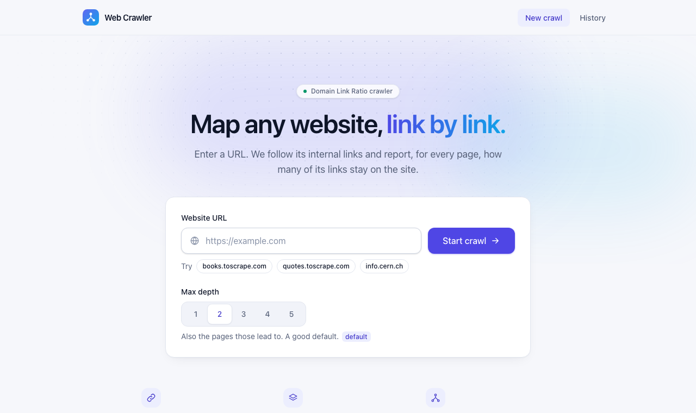
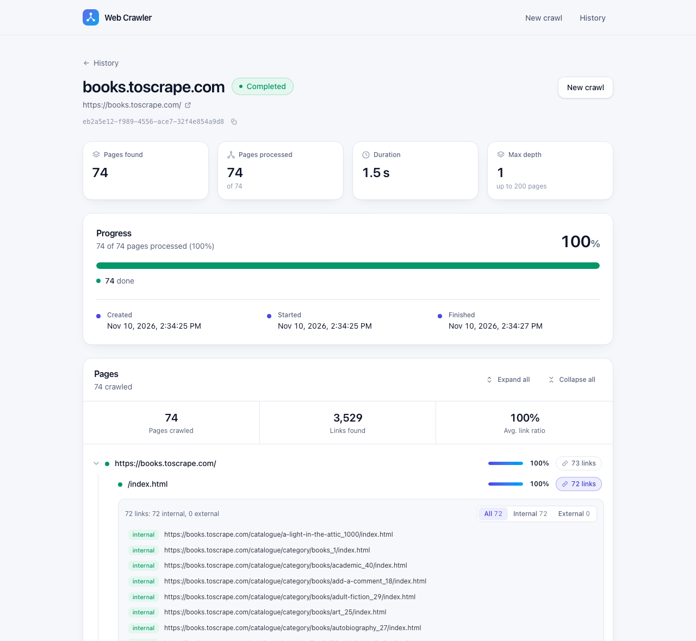
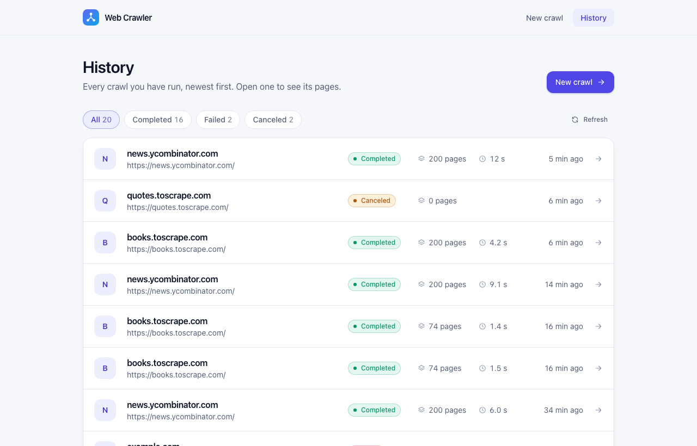
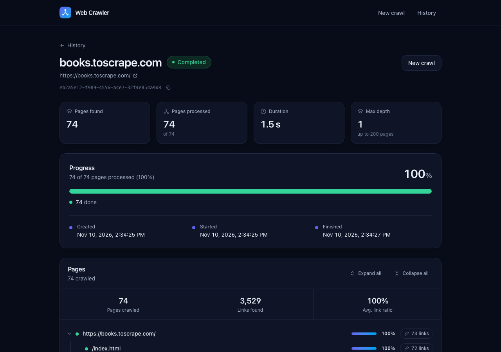
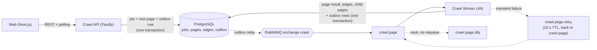

# Web Crawler

A job-based web crawler. Submit a URL, the crawl runs asynchronously on a pool of workers, and the UI shows live progress and then a tree of the pages found, each with its **Domain Link Ratio** (links that stay on the site ÷ all links on the page).

**Stack:** Node 24 / TypeScript in a pnpm monorepo · Fastify API · RabbitMQ · PostgreSQL (plain SQL) · Next.js (React) UI · Docker Compose · vitest.

## Quick start

```bash
docker compose up --build        # the first build takes several minutes (it installs dependencies)
```

Then open **http://localhost:3100**, click an example site (try `books.toscrape.com`) and press *Start crawl*. The API is on http://localhost:4000 and RabbitMQ's UI on http://localhost:15672. To run the services on your machine instead, see [Running locally](#running-locally).

For a one-page overview read [SUBMISSION.md](SUBMISSION.md). Design detail: [Architecture](docs/ARCHITECTURE.md) and [Decisions](docs/DECISIONS.md) (short ADRs).

## Contents

[Requirements coverage](#requirements-coverage) · [Screenshots](#screenshots) · [Architecture and key choices](#architecture-and-key-architectural-choices) · [Running locally](#running-locally) · [Tests and CI](#tests-and-ci) · [Operational behavior](#operational-behavior) · [Verifying it works](#verifying-it-works) · [API](#api) · [Job lifecycle](#job-lifecycle) · [Assumptions and trade-offs](#assumptions-and-trade-offs) · [SQL model and performance](#sql-model-and-performance) · [Event-driven design](#event-driven-design) · [Known limitations](#known-limitations) · [First, cut, next](#what-i-built-first-what-i-cut-what-is-next)

## Requirements coverage

Each item of the brief, and where it is met:

| Requirement | Status | Where |
|---|---|---|
| Two processes (API, worker), a broker, a SQL database, local Docker Compose | Done | `apps/api`, `apps/worker`, RabbitMQ, Postgres; `docker-compose.yml` ([Running locally](#running-locally)) |
| Job lifecycle: GUID, URL, 5 statuses, created/started/completed, failure reason | Done | [Job lifecycle](#job-lifecycle) |
| API: create `{url, maxDepth?}` → `{jobId}`, status, tree, paginated history, cancel (optional) | Done | [API](#api) |
| Crawl HTML only, default depth 2, relative links, fragments, duplicate URLs | Done | [Assumptions](#assumptions-and-trade-offs), `packages/core` |
| Page limit (200) and HTTP timeouts and retries | Done | [Retries](#event-driven-design), [Known limitations](#known-limitations) |
| Domain Link Ratio, start host, ignored schemes, 0 when no links | Done | [Assumptions](#assumptions-and-trade-offs) |
| Idempotent worker; retries for transient failures; dead-letter queue | Done | [Event-driven design](#event-driven-design) |
| README: message schema, idempotency, retry policy, DLQ handling | Done | [Event-driven design](#event-driven-design) |
| UI: Start Crawl, Job Details (progress, tree), History; loading and error states | Done | [Screenshots](#screenshots); progress is polling |
| Unit tests (normalization, ratio) and a fixture-based integration test | Done | [Tests and CI](#tests-and-ci) |
| Structured logs with `jobId` / `correlationId`; health endpoints for API and worker | Done | [Operational behavior](#operational-behavior), [Verifying](#verifying-it-works) |
| Clean separation of API, domain, infrastructure | Done | [Architecture](#architecture-and-key-architectural-choices) |
| README: how to run, key choices, known limitations; first / cut / next; assumptions | Done | this file |
| CI (optional) | Workflow in repo | `.github/workflows/ci.yml` ([Tests and CI](#tests-and-ci)) |
| SSE / SignalR (stretch) | Not done | the UI polls every 1.5 s, which the brief accepts |
| **.NET 8 / ASP.NET Core** | **Deviation** | built in Node/TypeScript by agreement; same architecture ([Assumptions](#assumptions-and-trade-offs)) |

## Screenshots

**Start a crawl.** A URL, a 0–5 depth with a plain-English description of each, and one-click example sites.



**Job details.** Status, live duration, a stacked progress bar by page status, a created/started/finished timeline, then the page tree. Each page shows its Domain Link Ratio; press its link count to list the links, filtered internal or external.



**History.** Newest first, with Status, Pages, Duration, Created and Finished columns, filterable by status (on the server) and paginated with a cursor.



Light and dark themes follow the system setting, and the layout works down to phone width.



## Architecture and key architectural choices



| Path | Role |
|---|---|
| `apps/api` | Fastify REST API. Creates jobs, serves status, tree, page links and history, cancels jobs, fails jobs that never finish. Runs DB migrations on startup. |
| `apps/worker` | RabbitMQ consumer. Fetches one page per message, extracts links, writes results, tracks progress. |
| `apps/web` | Next.js UI: Start Crawl, Job Details (polling, tree, per-page links), History. |
| `packages/core` | Domain logic and shared contracts, with no database or broker library: URL normalization, link extraction, Domain Link Ratio, tree building, message types, queue topology, env parsing, and the outbox mechanics (I/O is passed in). |
| `db/migrations` | Numbered `.sql` files, applied in order. Plain SQL via `pg`, no ORM. |

Dependencies point inward: apps import `core`; `core` imports no app. The worker's pipeline (`apps/worker/src/pipeline.ts`) is a plain function that takes its dependencies, separate from the RabbitMQ plumbing, so it is tested directly against Postgres.

**The choices that shape it** (each has a short record in [docs/DECISIONS.md](docs/DECISIONS.md)):

- **One message per page, not per job.** Work spreads across workers, a slow page never stalls a job, and retries and dead-lettering apply to a single page. The cost is that de-duplication, the page budget and completion detection must be exact in the database.
- **An idempotent page transaction.** Claim the page (`UPDATE … WHERE status = 'queued'`), record its links, create child pages, update counters, all in one transaction under a job-row lock. A message delivered twice changes nothing.
- **A transactional outbox.** Messages are written in the same transaction as the state they describe and published afterwards by a relay, so a crash or a broker outage can never leave work without a message, and the API keeps accepting jobs while RabbitMQ is down.
- **Two-level retries and a dead-letter queue.** Quick in-process retries with backoff, then a TTL retry queue, then the DLQ; permanent failures are recorded on the page, not retried.
- **Postgres with plain SQL, keyset pagination and measured indexes.** The interesting parts are locks and conditional updates, which stay visible and directly testable.
- **A domain package with no I/O,** so the rules that decide correctness (normalization, the ratio, the tree, the topology) are pure and exhaustively unit-tested.
- **Scales by adding workers.** They are stateless competing consumers; workers on the same job serialize on a short row lock, different jobs run in parallel.

## Running locally

Prerequisites: Node 24, pnpm 12, Docker.

```bash
pnpm install
docker compose up -d postgres rabbitmq     # infrastructure
cp .env.example .env && set -a && . ./.env && set +a

pnpm --filter @alteva/api start            # http://localhost:4000  (applies migrations)
pnpm --filter @alteva/worker start         # its health endpoint is on :4001
pnpm dev                                   # web on http://localhost:3000
```

RabbitMQ's management UI is at http://localhost:15672 (user and password are in `docker-compose.yml`). `pnpm --filter @alteva/api start` runs the TypeScript directly (convenient for development); the production form is the compiled bundle: `pnpm build:services`, then `pnpm --filter @alteva/api start:prod`.

Or run everything in containers:

```bash
docker compose up --build        # postgres, rabbitmq, api, worker, web; each has a healthcheck
```

The api is on http://localhost:4000, the web app on **http://localhost:3100** (3000 is left free for `pnpm dev`), and RabbitMQ's UI on :15672. The api waits for Postgres and RabbitMQ to be healthy and runs the migrations, and the worker and web wait for the api. The first build downloads base images and can take several minutes. The images are snapshots of the code at build time: after editing code, rebuild the service you changed (`docker compose up -d --build web`, or `api` / `worker`), or you will keep running the old version. `NEXT_PUBLIC_API_URL` is baked into the web bundle at build time (a build arg in `docker-compose.yml`), so it must be the api address as the *browser* sees it. Don't run the containers and the host processes at once: they compete for the same ports and queue.

The containers are built for running, not just for demonstrating: the api and worker are compiled to a single file each (no `node_modules`, TypeScript or pnpm in their images), run as the unprivileged `node` user with Node as PID 1, with a read-only filesystem and no extra Linux capabilities. Postgres and RabbitMQ are published to the host's loopback only. The database and broker passwords come from the environment (`POSTGRES_PASSWORD`, `RABBITMQ_PASSWORD`, see `.env.example`), defaulting to development values you must change before running anywhere else. Workers are stateless competing consumers, so `docker compose up -d --scale worker=3` runs three (in a test, a 200-page crawl completed with the work split 89/50/61 and exactly 200 distinct pages, and stopping every worker mid-crawl and restarting them lost and duplicated nothing). The api and worker images are about 175 MB each, because they hold only Node and the compiled file. The Dockerfile installs dependencies with `--frozen-lockfile` and skips pnpm's per-package release-age check (`--config.minimumReleaseAge=0`), which is for choosing new versions on a developer's machine and costs one registry round-trip per package: minutes on a slow link. The lockfile's integrity hashes are still enforced.

Health: `GET :4000/health` (database + RabbitMQ). The worker serves `GET :4001/health` (database + broker channel); when run in compose that port is internal, so check it with `docker compose exec worker wget -qO- http://127.0.0.1:4001/health` (or read `docker compose ps`, which uses it as the container healthcheck).

Crawl targets must be reachable from where the service runs: in compose, `localhost` means the container itself, so use a public site (such as `books.toscrape.com`) there. The local fixture site below needs the host-run services.

## Tests and CI

```bash
pnpm test                 # all packages; database tests skip with a warning if Postgres is down
pnpm test:integration     # starts compose Postgres, then fails (not skips) if it is unreachable
pnpm lint                 # type-checks every package, and lints the web app
```

The suites, **605 tests** in all (core 113, api 174, worker 169, web 149):

- **Unit tests for the rules the brief names**: URL normalization (relative links, fragments, ports, trailing slashes, `<base href>`) and the Domain Link Ratio (`packages/core/test`).
- **Integration tests over local HTML fixtures**: a fixture site is served over real HTTP and crawled by the real worker pipeline into a real Postgres, asserting exact pages, edges, ratios, the depth limits (0, 1, 2) and the page limit, skipped and failed pages, and job completion (`apps/worker/test/crawl.integration.test.ts`).
- **Idempotency**: every message delivered twice, and the same message delivered concurrently, change nothing (`idempotency.test.ts`).
- **Event-driven behavior**: retry and dead-letter routing, error classification, the outbox (atomicity, ordering, partial failure, concurrent relays), and the database limits against a real Postgres.
- **API and UI**: every route including pagination and filtering, validation, and CORS; and the UI components, including the polling hook, history filtering and stale-response handling.

Database tests run in a throwaway schema, so they never touch real tables. `.github/workflows/ci.yml` runs lint, all tests against a Postgres service (failing, not skipping, if it is missing), the web build, and a Docker image build on every push and pull request.

## Operational behavior

What the processes do beyond the happy path, so they are safe to deploy, restart and run unattended:

- **Graceful shutdown.** On SIGTERM both services stop taking new work, let what is in progress finish and be acknowledged, publish what it queued, then close the broker, the database pool and the health server, and exit 0. It gives up after 25 s (compose allows 30 s). A page cut off by that is not lost: its message was never acknowledged, so it is redelivered, and the worker is idempotent. A deliberate broker disconnect during shutdown is not reported as a connection loss.
- **Fail fast on bad configuration.** Environment variables are parsed strictly at startup (`PORT=abc`, a blank `DEFAULT_MAX_PAGES`, a `DATABASE_URL` of the wrong kind, a default depth beyond the page limit): the service exits with a message naming the variable and never echoing a connection string.
- **Database limits.** Every connection sets a statement timeout (60 s), a lock timeout (30 s) and an idle-in-transaction timeout (60 s), and the pool has a connection timeout and TCP keep-alive. A hung query or a client that died mid-transaction therefore cannot hold a job's row lock, and with it every worker on that job, indefinitely. A statement or lock timeout is classified as transient and retried through the retry queue. (Migrations lift the statement timeout for themselves.)
- **API server timeouts.** A request that arrives too slowly (30 s) or an idle connection (60 s) is closed; Node's defaults for both are no limit.
- **Crash handling.** An unhandled rejection or uncaught exception is logged as a structured fatal error and the process exits, so the container restarts a clean one. Losing the broker connection also exits the worker (the API reconnects by itself, see above).

## Verifying it works

Everything below was run against the real stack (api, worker, RabbitMQ, Postgres). The fixture-site steps need the **host-run** services (see *Running locally*), because the fixture site listens on the host's `127.0.0.1`; with compose, use a public site such as `https://books.toscrape.com/` instead (read the logs with `docker compose logs -f worker`). Serve the test site, whose correct answers are known:

```bash
pnpm --filter @alteva/worker fixtures        # http://127.0.0.1:8099/  (static HTML, 6 pages)
```

**Automated:** `pnpm test:integration` (see [Tests and CI](#tests-and-ci)).

**Happy path.** `POST /api/jobs` → poll → status → tree:

```bash
JOB=$(curl -s -X POST localhost:4000/api/jobs -H 'content-type: application/json' \
  -d '{"url":"http://127.0.0.1:8099/","maxDepth":2}' | python3 -c "import sys,json;print(json.load(sys.stdin)['jobId'])")
curl -s localhost:4000/api/jobs/$JOB         # Completed, progress 6/6, timestamps set
curl -s localhost:4000/api/jobs/$JOB/tree    # nested tree
```

Expected tree and ratios (`maxDepth` 2; with `maxDepth` 1 `/deep/page` is not crawled and the job ends at 5/5; with `maxDepth` 0 only `/` is crawled, 1/1, and its 5 links are recorded but not followed):

| Page | Status | Links | Internal | Ratio | Why |
|---|---|---|---|---|---|
| `/` | done | 5 | 4 | **0.8** | `/a`, `/a#section`, `/b/`, `./b` collapse to two links; `mailto:` is ignored; one external link |
| `/a` | done | 3 | 3 | **1** | `/`, `/b`, `/deep/page` |
| `/b` | done | 2 | 1 | **0.5** | one external link |
| `/deep/page` | done | 2 | 2 | **1** | `next` (beyond max depth: an edge, never fetched) and `../a` |
| `/doc.pdf` | skipped | | | none | `application/pdf`: HTML only |
| `/missing` | failed | | | none | HTTP 404, not retried (permanent) |

Also try, in the UI (`http://localhost:3000`) or with curl: **History** (`/api/jobs?limit=2`, then `&cursor=…`), **validation** (`{"url":"ftp://x","maxDepth":-1}` → 400 with per-field details, as is a depth above 200), **cancel** (a finished job gives 409; a running one becomes `Canceled` and the worker skips its remaining pages), and unknown/malformed ids (404 / 400).

**Page links, counts and the outbox.** Pick a page id from the tree (`.tree.id`) and list its links; the job summary breaks pages down by status; and every outbox row should end up published:

```bash
curl -s localhost:4000/api/jobs/$JOB/pages/<pageId>/links     # { total, truncated, links: [{ url, isInternal }] }
curl -s localhost:4000/api/jobs/$JOB                          # ... "pageCounts": { "queued": 0, "done": 6, ... }
docker exec alteva-postgres psql -U alteva -d alteva_db -c \
  "select count(*) total, count(*) filter (where published_at is null) unpublished from outbox"   # unpublished = 0
```

**Broker outage (the outbox earning its keep).** With the compose stack up:

```bash
docker compose stop rabbitmq
curl -s localhost:4000/health          # 503, "broker": false, but the API is still up
curl -s -i -X POST localhost:4000/api/jobs -H 'content-type: application/json' \
  -d '{"url":"https://books.toscrape.com/","maxDepth":1}'    # still 202; the job stays Pending
docker compose start rabbitmq          # the API reconnects, the relay publishes, the crawl completes
```

During the outage the job's root message sits in `outbox` with `published_at` null and `last_error` set; afterwards it is published and the job completes (74 pages in the run I did).

**Retries and the DLQ.** A closed port is a transient failure:

```bash
curl -s -X POST localhost:4000/api/jobs -H 'content-type: application/json' -d '{"url":"http://localhost:59999/"}'
```

Watch the worker log: `scheduling retry` (next attempt 2), again (attempt 3), then `retries exhausted, dead-lettering`. After about 25 s the job is `Failed` with *"Could not fetch the start page: fetch failed (ECONNREFUSED)"*. Cancel it while it waits and the next retry logs `job is Canceled` and stops.

**Idempotency, by hand.** Stop the worker, create a job (its root message queues), publish a second copy of that message through RabbitMQ's HTTP API, then restart the worker:

```bash
curl -s -u alteva:alteva_password -H 'content-type: application/json' -X POST \
  localhost:15672/api/exchanges/%2F/crawl/publish -d '{"properties":{"delivery_mode":2},
  "routing_key":"page","payload_encoding":"string",
  "payload":"{\"messageId\":\"copy\",\"jobId\":\"<JOB>\",\"url\":\"http://127.0.0.1:8099/\",\"depth\":0,\"parentPageId\":null,\"correlationId\":\"x\"}"}'
```

The worker logs `page not processed  duplicate` for the second copy, and Postgres still has exactly 6 pages, 6 distinct URLs and 12 edges (`select count(*) from pages/edges where job_id=…`). Publishing `this is not json` the same way logs `malformed message` and lands in `crawl.page.dlq` (queue sizes: http://localhost:15672).

**Observability.** `GET :4000/health` and `GET :4001/health`. Send `-H 'x-correlation-id: my-id'` on create, then `grep my-id` in both the api and worker logs: every line carries `correlationId` and, for job-scoped lines, `jobId`.

## API

| Method and path | |
|---|---|
| `POST /api/jobs` `{ url, maxDepth? }` | `202 { jobId }` with a `Location` header: the job and its first message are committed, the crawl happens asynchronously. `url` must be http(s). `maxDepth` is any whole number from 0 (the start page only; its links are listed but not followed) up to the page limit, default 2. |
| `GET /api/jobs/:id` | Status, timestamps, failure reason, `progress: { pagesDiscovered, pagesProcessed }` and `pageCounts: { queued, done, skipped, failed }`. |
| `GET /api/jobs/:id/tree` | Nested tree: `id, url, depth, status, domainLinkRatio, outgoingCount, children`. Partial while running. |
| `GET /api/jobs/:id/pages/:pageId/links` | The outgoing links stored for one page, each marked `isInternal`: `{ total, truncated, links }` (at most 1000 returned). The UI loads these when you press a page's link count. |
| `GET /api/jobs?cursor=&limit=20&status=` | History, newest first, keyset pagination, returns `nextCursor`. `status` filters on the server and takes one or several statuses (`Failed`, `Pending,Running`); pass the same `status` with each `cursor`. An unknown status is a 400. |
| `GET /api/jobs/counts` | `{ total, byStatus }` over the whole history, for the filter chips in the UI. |
| `POST /api/jobs/:id/cancel` | Idempotent. 409 for a job that already completed or failed. |

Errors always look like `{ "error": { "code", "message", "details?", "correlationId" } }`. Send `x-correlation-id` to choose the id; otherwise one is generated. It appears in every log line and in the messages the job publishes.

## Job lifecycle

| Status | When |
|---|---|
| `Pending` | Created; the root message is queued; no page processed yet. |
| `Running` | The first page has been processed. |
| `Completed` | Every discovered page has been processed (including pages that were skipped or failed: a broken link deeper in a site does not fail the job). |
| `Failed` | The **start page** cannot be crawled (HTTP error, unreachable after retries, or not HTML), or the job exceeded `JOB_TIMEOUT_MINUTES` (default 30; a once-a-minute check in the api fails stuck jobs). `failureReason` says which. |
| `Canceled` | `POST /api/jobs/:id/cancel`. The worker skips the job's queued pages without fetching them. |

## Assumptions and trade-offs

- **Node/TypeScript instead of .NET 8.** The assignment names ASP.NET Core; I was given permission to build it in Node/TypeScript (Fastify, Next.js), keeping the same architecture: separate API and worker processes, a broker, SQL persistence.
- **Domain Link Ratio** is `internal / total` over a page's *distinct outgoing links*, where:
  - the starting domain is the host of the job URL, with `www.` ignored (`www.example.com` = `example.com`); any other subdomain is external;
  - `mailto:`, `tel:` and every non-http(s) scheme are ignored;
  - a link back to the page itself (an in-page `#anchor`, or a self link) is not an outgoing link, so it cannot inflate the ratio;
  - `/a`, `/a#x`, `/a/`, `http://site/a` and `https://www.site/a` are one link;
  - a page with no links has ratio 0 (the UI shows "no links found" rather than 0%).
- **Redirects on the start URL.** The site's real origin is whatever the start page finally resolves to. `http://example.com` redirecting to `https://www.example.com` works, and so does a move to another domain, which then becomes the starting domain. The start page is stored under its final address.
- **Links are `<a href>` and `<area href>`**, resolved the way a browser would: against the page's `<base href>` if it has one, otherwise against the page's final URL (after redirects).
- **`maxDepth` has no arbitrary bounds.** The spec gives a default of 2 and no limits, so the API accepts any whole number from 0 up to the page limit (200). A crawl can never reach more pages than that, so a deeper value could not change the result, which makes it the one ceiling with a reason (it also keeps the value inside the database's integer). The UI offers 0–5.
- **Only internal pages are crawled.** External and out-of-budget links are stored as edges but not fetched. Links beyond `maxDepth` are recorded as edges only.
- **Link order decides what fits in the page budget.** With `max_pages` reached, links are taken in document order.
- **Page-level redirects are not de-duplicated.** If `/old` redirects to `/new` and both are linked, both are crawled.

## SQL model and performance

- **Three tables** (`jobs`, `pages`, `edges`). `pages` is unique on `(job_id, normalized_url)`, which is both the duplicate-URL rule and the idempotency anchor; `edges` is keyed on `(job_id, from_page_id, to_url)`. `to_url` is text, not a foreign key, because external and out-of-budget links have no page row.
- **Indexes** match the queries: `jobs (created_at DESC)` for history, `pages (job_id, status)` for progress and completion, `pages (parent_page_id)` for the tree. History uses **keyset pagination**, not `OFFSET`, so page 50 costs the same as page 1.
- **Counters are denormalised** on `jobs` (`pages_discovered`, `pages_processed`), so progress is one row read instead of a `COUNT(*)` per poll.
- **One statement per page, not per link.** Edges and child pages are inserted with `unnest(...)` in bulk, and a page's whole write is a single short transaction. No network I/O happens inside it: the fetch comes first.
- **History filters by status in SQL**, with an index on `(status, created_at DESC, id DESC)`. Measured on 200,000 jobs: a rare status (24 jobs) takes 0.3 ms with the index versus 14.5 ms without (a full scan, growing with the table); common statuses were already fast through the `created_at` index, and the planner keeps using that for them. The per-status counts take about 19 ms at that size with or without it, which is fine for loading a page; with millions of jobs they would be kept as counters.
- **The outbox is cheap to poll**: a partial index covers only unpublished rows, so the relay's query touches almost nothing in steady state, and a second partial index makes the cleanup delete a range scan.
- **The tree is one query** (all of a job's pages, ordered) nested in memory; the page budget bounds its size.
- **Trade-off: the job row is locked for each page's transaction.** That serializes workers *within one job* but not across jobs, and it is what makes the page cap and the completion check exact. The critical section is a few statements long. If one huge job's throughput ever mattered, the next step is an atomic `UPDATE ... RETURNING` counter instead of a row lock.

## Event-driven design

**Message schema.** One message per page (not per job), JSON on exchange `crawl`, routing key `page`:

```json
{ "messageId": "uuid", "jobId": "uuid", "url": "https://site/page", "depth": 1, "parentPageId": 42, "correlationId": "..." }
```

`parentPageId` is `null` for the start page.

**Idempotency** (delivery is at-least-once). Every page and edge is keyed by job, so a redelivered message cannot create rows or double-count:

- `pages` has `UNIQUE (job_id, normalized_url)`; `edges` has `PRIMARY KEY (job_id, from_page_id, to_url)`.
- The worker claims a page with `UPDATE pages SET status = … WHERE … AND status = 'queued' RETURNING id`. No row back means a duplicate delivery: it acks and does nothing.
- All writes for a page (claim, edges, child pages, the child messages, job counters) happen in **one transaction**, using a transactional outbox (below), and the message is acked after it commits.
- The job row is locked (`FOR UPDATE`) for the transaction. That serializes workers on one job and makes the `max_pages` cap exact under concurrency.
- A job completes when `pages_processed = pages_discovered`, updated in a single statement.

**Transactional outbox.** A message is never published directly from a request or a page's processing. Instead it is inserted into an `outbox` table *in the same transaction* as the state it describes: the API writes the job, its root page and the root message together; the worker writes a page's result, its child pages and their messages together. A relay (every API and worker process runs one) then publishes unpublished rows with publisher confirms and marks them published, claiming rows with `FOR UPDATE SKIP LOCKED` so relays never publish a row twice between them. So a crash or a broker outage can no longer leave a page `queued` with no message, and creating a job does not need the broker to be up: the API starts without RabbitMQ, keeps accepting jobs while it is down, and reconnects on its own. Publishing is at-least-once (a crash between publish and marking republishes), which the idempotent worker is built for. Published rows are deleted after 24 hours.

**Retries.** Topology: `crawl.page` (work), `crawl.page.retry` (10s TTL, dead-letters back to `crawl.page`), `crawl.page.dlq`. Up to **3 attempts** in total, counted in an `x-attempt` header. This is the second level: the fetch itself first retries transient errors in-process (up to 2 more tries, exponential backoff with jitter from 500 ms, honouring a `Retry-After` of up to 10 s), all within a 45 s budget per page.

- *Transient* (retried): timeouts, `ECONNRESET`/`ECONNREFUSED`, DNS errors, HTTP 5xx, 408 and 429, database connection errors.
- *Permanent* (no retry, recorded and counted as processed): HTTP 4xx (except 408 and 429), non-HTML content (`skipped`), oversized bodies, TLS and malformed-URL errors, and redirects that loop, exceed 5 hops, leave http(s), or go from https down to http.

**Dead letters.** Routed to `crawl.page.dlq`: malformed messages (bad JSON or schema), messages whose retries are exhausted, and unrecoverable processing errors. For exhausted or unrecoverable ones the page is first marked `failed` and counted as processed, so the job can still complete.

## Known limitations

- **JavaScript-rendered sites are not crawled.** The worker fetches raw HTML and does not run scripts. A client-side app (for example a React single-page app that serves an empty `<div id="root">`) has no links in its HTML, so it is reported as one page with "no links found". Supporting those sites needs a headless browser (e.g. Playwright) in the worker.
- **Not hardened for the open internet.** There is no authentication, TLS termination, security headers or request rate limiting: put it behind a gateway that provides them. Metrics are limited to logs and the health endpoints.
- **No SSRF protection.** The API will crawl any http(s) URL, including `localhost` and private addresses. Fine locally; it needs an allow/deny list before exposure.
- **No `robots.txt`, rate limiting or politeness delay.**
- **Database outage beyond the retry budget.** If the database is still down when retries run out, the page cannot be marked failed and stays `queued` until the DLQ message is replayed (replaying is safe: duplicates are no-ops).
- **Pages that redirect elsewhere are not merged.** Only the start page's redirect is followed into a canonical origin (see assumptions).
- **Fixed limits.** `max_pages` (200) is configuration, not a request field. Response bodies over 2 MB are treated as failures, and a page gets 10 s per attempt and 45 s overall. Charset is assumed to be UTF-8.
- **Outbox relay latency.** A message reaches the broker after the relay's next pass; it is woken right after each commit, so normally within milliseconds, and polls once a second as a fallback. If the broker is down, jobs stay `Pending` until it returns (or the job timeout fails them).
- **Polling, not push.** The UI polls every 1.5s.
- **The worker exits if it loses the broker.** It can do nothing without it, so it relies on the container restart policy (compose sets one) and reconnects on start. The API does not: it keeps serving, reports `broker: false` on `/health`, and reconnects by itself.

## What I built first, what I cut, what is next

**First: the parts the rubric weights most and that are hardest to get right later.**
1. The pure domain logic in `packages/core` (URL normalization, link extraction, the ratio) with unit tests, because correctness and edge cases carry the most weight and pure functions are cheap to test thoroughly.
2. The schema and the worker pipeline: the single-transaction, idempotent page processing, later joined by the transactional outbox. Everything else depends on this being right, so it got the most testing, including a test that delivers every message twice.
3. Retry and DLQ topology, then the API, then the UI. The integration test against local HTML fixtures ties it together.
4. Hardening afterwards, in the order the risks showed up: the transactional outbox, a fuller HTTP retry policy, server-side history filtering, the operational behavior described above, and a UI redesign.

**Cut, to stay inside the time box**
- JavaScript rendering, `robots.txt` / rate limiting / politeness delays, and SSRF protection (all under known limitations).
- Server push (SSE): the UI polls every 1.5s, which the assignment accepts.
- Authentication and per-user job history.
- A per-request `maxPages` (it is a server setting), tree virtualisation for very large crawls, and metrics/tracing beyond structured logs and health endpoints.

**Next, in priority order**
1. A **headless-browser** fetch path for JavaScript-rendered sites.
2. `robots.txt` and per-host rate limiting, plus an SSRF allow/deny list, before exposing this anywhere real.
3. SSE for live progress, metrics (queue depth, outbox backlog, retry and DLQ rates) and tracing across api, broker and worker.
4. DLQ tooling: inspect and replay.
5. For very large jobs, replace the per-job row lock with an atomic counter (ADR-004).
