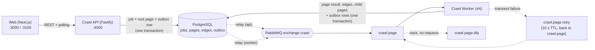

# Architecture

A crawl is a **job**. A job is a tree of **pages**; every page is crawled by one **message**.

## Components

| Component | Responsibility | Depends on |
|---|---|---|
| `packages/core` | Pure domain logic and the contracts both services share: URL normalization, link extraction, Domain Link Ratio, the page tree, message types, queue topology, and the outbox mechanics. Imports no database or broker library: I/O is passed in. | nothing |
| `apps/api` | Creates jobs, serves status, tree, page links and history, cancels jobs, fails jobs that never finish. Runs migrations. | core, Postgres, RabbitMQ |
| `apps/worker` | Consumes page messages. Fetches the page, extracts links, writes the result, creates child pages. | core, Postgres, RabbitMQ |
| `apps/web` | Start Crawl, Job Details (polling, tree, per-page links), History. | the API |

Dependencies point inward: apps import `core`; `core` imports no app.

## One page, end to end

1. **`POST /api/jobs`** validates the URL and depth, then in **one transaction** inserts the job, its root page (`depth 0`, `queued`) and a message in the `outbox` table. It answers `202` and nudges its relay.
2. The **relay** publishes outbox rows to the `crawl` exchange (publisher confirms), marking each published. Any process may run a relay: rows are claimed with `FOR UPDATE SKIP LOCKED`.
3. A **worker** takes the message from `crawl.page` (prefetch 5, manual ack) and, before fetching, skips it if the job is finished or canceled.
4. It **fetches** the page (outside any transaction): 10 s per attempt, 45 s in total, redirects followed by hand (at most 5, never https to http), body capped at 2 MB, HTML only. Transient failures are retried in-process with backoff and `Retry-After`.
5. In **one transaction** it locks the job row, then: claims the page (`UPDATE ... WHERE status = 'queued'`; no row back means a duplicate delivery), records the page's metrics and edges, inserts child pages for new internal links within the depth and page budget, queues their messages in the outbox, and updates the job's counters, completing the job when processed equals discovered.
6. It **acks**. Its relay publishes the children, and the cycle repeats until nothing is left.

Failure at any point is safe: before the commit nothing happened; after it, the messages are already in the outbox and the relay will send them. See ADR-005 and ADR-004.

## Data model

| Table | Purpose |
|---|---|
| `jobs` | The job: url, start host, limits, status, timestamps, failure reason, `pages_discovered` / `pages_processed`, and `site_origin` (where the site really lives after redirects). |
| `pages` | One row per normalized URL per job, with parent, depth, status (`queued`, `done`, `skipped`, `failed`), ratio and counts. `UNIQUE (job_id, normalized_url)`. |
| `edges` | Every outgoing link of every crawled page, internal or external. `PRIMARY KEY (job_id, from_page_id, to_url)`. |
| `outbox` | Messages waiting to be published. Partial index on the unpublished rows only. |

Migrations are numbered `.sql` files in `db/migrations`, applied in order by the API at startup.

## Job states

`Pending` → `Running` → `Completed`, or `Failed` (start page not crawlable, or the job timed out), or `Canceled`. A `Failed` or `Canceled` job's remaining messages are acknowledged and ignored.

## Observability

Structured JSON logs (pino). Every line carries `correlationId`; job-scoped lines carry `jobId`. The correlation id enters at the API (the `x-correlation-id` header, or generated), travels inside every message, and appears in the worker's logs. `GET /health` on the API (database, broker) and the worker (database, channel).

## Scaling

Workers are stateless competing consumers: add replicas (`docker compose up -d --scale worker=3`). Within one job, workers are serialized by the job row lock; across jobs they run in parallel (ADR-004).
